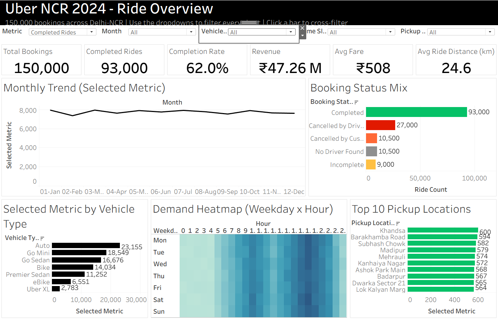

# Uber NCR 2024 — Dynamic Ride Analytics Dashboard (Tableau)

An interactive Tableau dashboard built on **150,000 real-format Uber ride bookings from the Delhi-NCR region of India (Jan–Dec 2024)**. It answers: *how much demand is there, when and where does it peak, how much revenue is earned, and why do a third of rides fail?*



## Dataset

| | |
|---|---|
| Name | Uber Ride Analytics Dashboard — `ncr_ride_bookings.csv` |
| Origin | Kaggle ("Uber Ride Analytics 2024", NCR bookings); downloaded from the GitHub mirror [aymen016/uber-analytics-dashboard](https://github.com/aymen016/uber-analytics-dashboard) |
| Size | 150,000 rows × 21 columns, 176 pickup locations, 7 vehicle types |
| Grain | One booking request (completed, cancelled, incomplete or no driver found) |

Note: the dataset reflects Uber's NCR operations, but parts of it were simulated by its Kaggle publisher (for example, cancellation shares are perfectly round numbers). Describe it as a "realistic Uber NCR dataset", not as official Uber data.

## Project structure

```
uber-ncr-dashboard/
├── data/
│   ├── raw/ncr_ride_bookings.csv        # original download
│   ├── clean/uber_rides_clean.csv       # output of clean_data.py (36 columns, git-ignored)
│   └── extract/uber_rides.hyper         # Tableau extract (git-ignored)
├── images/ride_overview.png             # dashboard screenshot
├── scripts/
│   ├── clean_data.py                    # cleaning + feature engineering (pandas)
│   └── build_workbook.py                # builds the .hyper extract + Tableau workbook XML
└── tableau/
    ├── Uber_NCR_Dashboard.twbx          # packaged workbook (data inside) ← open this
    └── Uber_NCR_Dashboard.twb           # same workbook, points at data/extract/
```

Rebuild everything with:
```bash
pip install -r requirements.txt
python scripts/clean_data.py
python scripts/build_workbook.py
```

## Opening the dashboard

Open `tableau/Uber_NCR_Dashboard.twbx` in **Tableau Public** (free, tested on version 2026.3) or in Tableau Desktop.
- Download Tableau Public at https://public.tableau.com/app/discover → *Create → Download Tableau Public*.
- To share the dashboard, choose *File → Save to Tableau Public*, then put the link on your CV or LinkedIn.

Tableau Public accepts only extract data sources, so `build_workbook.py` writes the data into a `.hyper` extract with Tableau's Hyper API and packs it into the `.twbx`.

## Data cleaning (`clean_data.py`)

- Stripped literal quotes from `Booking ID` / `Customer ID` (`"""CNR5884300"""` → `CNR5884300`)
- Booking IDs are **not unique** (1,233 collisions between different trips), so a `Ride Key` row id was added
- Time features: `Month` (`01-Jan`…), `Weekday`, `Hour`, `Time Slot` (5 day-parts), `Is Weekend`
- Outcome flags for rate maths: `Ride Count`, `Is Completed`, `Is Cancelled Customer`, `Is Cancelled Driver`, `Is No Driver`, `Is Incomplete`
- `Revenue` = booking value of **completed** rides only (incomplete rides also carry a fare in the source)
- `Failure Reason` = one column combining customer, driver and incomplete reasons plus "No Driver Found"
- `Distance Band` (0-5, 5-10, 10-20, 20-35, 35-50 km); unpaid bookings get `Payment Method = "Not Paid"`

## What makes it dynamic

| Feature | How it works |
|---|---|
| **Global dropdown filters**: Month, Vehicle Type, Time Slot, Pickup Location | Parameters feed one boolean calc, `Dashboard Filter`, which is applied to every sheet, so one choice updates both dashboards |
| **Metric switcher**: Bookings / Completed Rides / Revenue / Avg Fare / Completion Rate % | `Selected Metric` calc (a `CASE` on the parameter) drives the trend line, vehicle bars, heatmap and Top-10 pickups |
| **Click-to-filter** | Dashboard filter actions: click a bar in Booking Status, Vehicle Type, Monthly Trend, Rating or Payment Method to filter the rest of that dashboard |
| **Top-10 pickups** | Top-N filter ranked by whichever metric is selected |

### Dashboard 1 — Ride Overview
KPI tiles: Total Bookings · Completed Rides · Completion Rate · Revenue (₹ M) · Avg Fare · Avg Ride Distance
Charts: Monthly Trend (selected metric) · Booking Status Mix · Selected Metric by Vehicle Type · Demand Heatmap (Weekday × Hour) · Top 10 Pickup Locations

### Dashboard 2 — Cancellations & Operations
KPI tiles: Cancellation Rate · Driver Cancel Rate · Customer Cancel Rate · No Driver Found Rate · Avg Pickup ETA · Avg Driver Rating
Charts: Why Rides Fail (reason × status) · Booking Outcome by Time Slot · Revenue by Payment Method · Avg Driver Rating by Vehicle · Revenue by Distance Band

## Expected values (no filters applied) — use these to check the dashboard

| KPI | Value |
|---|---|
| Total bookings | 150,000 |
| Completed rides | 93,000 |
| Completion rate | 62.0% |
| Revenue | ₹47.26 M |
| Avg fare (completed) | ₹508 |
| Avg ride distance | 24.6 km |
| Cancellation rate | 25.0% (driver 18.0%, customer 7.0%) |
| No driver found | 7.0% |
| Avg pickup ETA (VTAT) | 8.5 min |
| Avg driver rating | 4.23 |

## Key insights

1. **Only 62% of booking requests become paid rides.** Driver cancellations (18%) cause 2.6× more lost rides than customer cancellations (7%).
2. **Demand peaks from 5–8 PM.** 6 PM alone has 12.4k bookings, the busiest hour of the day.
3. **Auto is the revenue leader** (₹11.7 M), ahead of Go Mini (₹9.4 M) and Go Sedan (₹8.5 M). Uber XL is a small niche (₹1.4 M).
4. **Driver-side reasons** ("customer related issue", "customer was coughing/sick", "personal & car issues", "more than permitted people") account for 27k lost rides, so they are the main thing to fix for ops.
5. **UPI is the main payment method**, ahead of cash, wallet and cards.
6. Revenue is spread evenly across pickup areas: the top locations (Barakhamba Road, Khandsa, Pataudi Chowk) each earn about ₹0.31 M.

## Manual build (fallback, Tableau Public / Desktop)

1. **Connect**: Text file → `data/clean/uber_rides_clean.csv`. Right-click `Hour`, `Month Num`, `Weekday Num`, `Ride Key` → *Convert to Dimension*.
2. **Parameters** (string, list): `Metric` = Bookings, Completed Rides, Revenue (INR), Avg Fare (INR), Completion Rate % · `Month` / `Vehicle Type` / `Time Slot` / `Pickup Location` = "All" + *Add values from field*. Right-click each → *Show Parameter*.
3. **Calculated fields**
   ```
   Dashboard Filter  = ([Month Param]="All" OR [Month]=[Month Param])
                       AND ([Vehicle Param]="All" OR [Vehicle Type]=[Vehicle Param])
                       AND ([Time Slot Param]="All" OR [Time Slot]=[Time Slot Param])
                       AND ([Pickup Param]="All" OR [Pickup Location]=[Pickup Param])
   Selected Metric   = CASE [Metric]
                         WHEN "Bookings" THEN SUM([Ride Count])
                         WHEN "Completed Rides" THEN SUM([Is Completed])
                         WHEN "Revenue (INR)" THEN SUM([Revenue])
                         WHEN "Avg Fare (INR)" THEN SUM([Revenue]) / SUM([Is Completed])
                         WHEN "Completion Rate %" THEN 100 * SUM([Is Completed]) / SUM([Ride Count])
                       END
   Completion Rate   = SUM([Is Completed]) / SUM([Ride Count])                  (format %)
   Revenue (INR M)   = SUM([Revenue]) / 1000000
   Avg Fare (INR)    = SUM([Revenue]) / SUM([Is Completed])
   Cancellation Rate = (SUM([Is Cancelled Customer]) + SUM([Is Cancelled Driver])) / SUM([Ride Count])
   Driver Cancel Rate   = SUM([Is Cancelled Driver]) / SUM([Ride Count])
   Customer Cancel Rate = SUM([Is Cancelled Customer]) / SUM([Ride Count])
   No Driver Found Rate = SUM([Is No Driver]) / SUM([Ride Count])
   Has Failure Reason   = NOT ISNULL([Failure Reason])
   ```
4. **Sheets**: put `Dashboard Filter` = True on Filters in each sheet, or do it once and choose *Apply to Worksheets → All using this data source*.
   - KPI tiles: drag the measure onto *Text*, set font size 26 bold.
   - Monthly Trend: `Month` → Columns, `Selected Metric` → Rows, mark = Line, show labels.
   - Booking Status Mix: `Booking Status` → Rows, `SUM(Ride Count)` → Columns, `Booking Status` → Color.
   - Vehicle Type: `Vehicle Type` → Rows, `Selected Metric` → Columns, sort descending.
   - Heatmap: `Weekday` → Rows (manual sort Mon→Sun), `Hour` → Columns, `Selected Metric` → Color, mark = Square.
   - Top 10 Pickup: `Pickup Location` → Rows, `Selected Metric` → Columns, Filter → Top → By field: Top 10 by `Selected Metric`.
   - Why Rides Fail: `Failure Reason` → Rows, `SUM(Ride Count)` → Columns, `Booking Status` → Color, filter `Has Failure Reason` = True.
   - Outcome by Time Slot: `Time Slot` → Rows, `SUM(Ride Count)` → Columns, `Booking Status` → Color (stacked).
   - Payment / Rating / Distance band: simple bar charts as described in the dashboard list above.
5. **Dashboards**: size 1400 × 900. Add a black title bar, the parameter controls row, the KPI row and two chart rows. Under *Dashboard → Actions → Add Filter action*, set Source = bar charts, Target = all sheets, Run on = Select.
6. **Colors**: Completed `#06C167`, Cancelled by Driver `#E11900`, Cancelled by Customer `#FF6937`, No Driver Found `#8F8F8F`, Incomplete `#FFC043`. Use black for single-colour bars.
