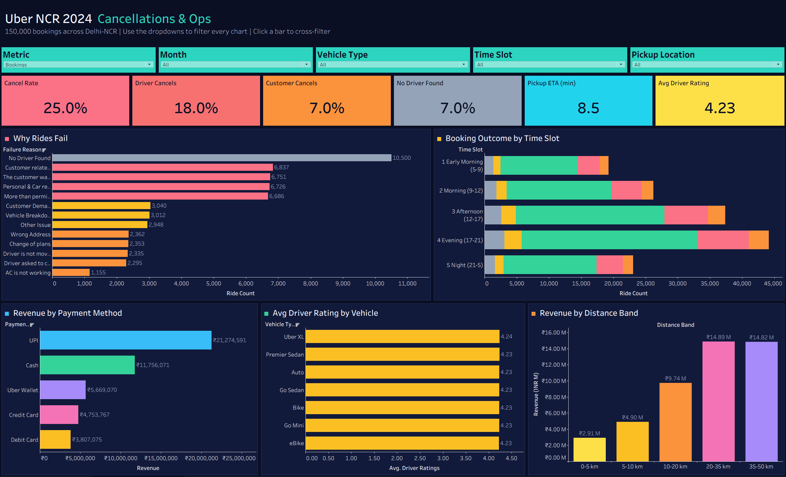

# Uber NCR Ride Analytics (Tableau)

A two-page Tableau dashboard built on 150,000 Uber booking requests from Delhi-NCR, January to December 2024. I wanted to answer four questions with it: how much demand there is, when and where it peaks, how much money the completed rides bring in, and why more than a third of requests never turn into a paid trip.




## What's in it

**Ride Overview**
- Six headline numbers: total bookings, completed rides, completion rate, revenue, average fare, average trip distance
- Monthly trend for whichever metric is selected
- Booking status mix (completed, cancelled by driver, cancelled by customer, no driver found, incomplete)
- Metric by vehicle type
- Weekday × hour demand heatmap
- Top 10 pickup locations

**Cancellations & Ops**
- Cancellation rate, driver and customer cancels, no-driver-found rate, average pickup ETA, average driver rating
- Lost rides by stated reason, coloured by who cancelled
- Booking outcome by time of day
- Revenue by payment method and by trip distance
- Driver rating by vehicle type

Five dropdowns sit at the top of both pages: Metric, Month, Vehicle Type, Time Slot and Pickup Location. They're Tableau parameters wired into a single boolean calculated field (`Dashboard Filter`) that every sheet filters on, so one change updates both pages. The Metric dropdown switches the trend, vehicle, heatmap and top-10 charts between bookings, completed rides, revenue, average fare and completion rate. Clicking a bar in most charts filters the rest of that page.

## Numbers to expect (no filters)

| | |
|---|---|
| Bookings | 150,000 |
| Completed rides | 93,000 (62.0%) |
| Revenue | ₹47.26 M |
| Average fare | ₹508 |
| Average trip distance | 24.6 km |
| Cancelled by driver / customer | 18.0% / 7.0% |
| No driver found | 7.0% |
| Average pickup ETA | 8.5 min |
| Average driver rating | 4.23 |

## What the data shows

- Only 62% of requests end as a paid ride. Drivers cancel 2.6 times as often as customers do (18% against 7%), so the bigger problem sits on the supply side.
- The four driver-side reasons ("customer related issue", "customer was coughing/sick", "personal & car related issues", "more than permitted people") account for 27,000 lost rides between them.
- Demand builds through the afternoon and peaks between 5 and 8 PM. 6 PM is the busiest hour, with about 12,400 bookings.
- Auto earns the most (₹11.7 M), followed by Go Mini (₹9.4 M) and Go Sedan (₹8.5 M). Uber XL is a small niche at ₹1.4 M.
- UPI is the most common way to pay, well ahead of cash, wallet and cards.
- Revenue is spread evenly across the city. The top pickup points (Barakhamba Road, Khandsa, Pataudi Chowk) each bring in around ₹0.31 M.

## Data

`ncr_ride_bookings.csv` from the Kaggle dataset "Uber Ride Analytics 2024", downloaded from the GitHub mirror [aymen016/uber-analytics-dashboard](https://github.com/aymen016/uber-analytics-dashboard). It has 150,000 rows and 21 columns, with one row per booking request, 176 pickup locations and 7 vehicle types.

The dataset is realistic but not official Uber data. Parts of it were simulated by the person who published it, which is why some of the shares come out as perfectly round numbers.

## Cleaning (`scripts/clean_data.py`)

- Stripped the literal quotes around `Booking ID` and `Customer ID` (`"""CNR5884300"""` became `CNR5884300`).
- Booking IDs turned out not to be unique (1,233 IDs are shared by different trips), so I added a `Ride Key` row ID.
- Added time fields: `Month`, `Weekday`, `Hour`, five `Time Slot` buckets and `Is Weekend`.
- Added 0/1 outcome flags (`Is Completed`, `Is Cancelled Driver` and so on) so rates are simple sums in Tableau.
- `Revenue` counts completed rides only. Incomplete rides carry a fare in the raw data, but that money was never earned.
- Merged the customer, driver and incomplete reason columns into one `Failure Reason` column.
- Grouped trips into distance bands (0-5, 5-10, 10-20, 20-35, 35-50 km) and set `Payment Method` to "Not Paid" where no payment happened.

## How the workbook is built

I didn't build the workbook by hand. `scripts/build_workbook.py` writes the cleaned data into a `.hyper` extract with Tableau's Hyper API, then generates the workbook XML: calculated fields, parameters, sheets, both dashboard layouts, filter actions and the colour theme. Tableau Public only accepts extract data sources, which is why the extract step is there. Keeping it all in a script means any change to the layout or colours is a code change I can rebuild and diff.

## Running it

```bash
pip install -r requirements.txt
python scripts/clean_data.py
python scripts/build_workbook.py
```

Then open `tableau/Uber_NCR_Dashboard.twbx` in [Tableau Public](https://public.tableau.com/app/discover) (free; I used version 2026.3) or Tableau Desktop. The `.twbx` file has the data packed inside, so it opens on any machine without running the scripts first. The dashboards size themselves to the window. Press F7 in Tableau for full-screen presentation mode.

## Project layout

```
uber-ncr-dashboard/
├── data/
│   ├── raw/ncr_ride_bookings.csv     original download
│   ├── clean/                        output of clean_data.py (not committed)
│   └── extract/                      .hyper extract (not committed)
├── images/                           dashboard screenshots
├── scripts/
│   ├── clean_data.py
│   └── build_workbook.py
├── tableau/
│   ├── Uber_NCR_Dashboard.twbx       packaged workbook, open this one
│   └── Uber_NCR_Dashboard.twb        same workbook, reads data/extract/
└── requirements.txt
```
